# VeyraX — Agentic Component Interface

<p align="center">
  
</p>

<p align="center">
  <a href="LICENSE"></a>
  
  
  <a href="#integrations"></a>
</p>

VeyraX is an infrastructure layer that connects AI agents to the tools people actually use.
One API key gives an agent (Claude, Cursor, your own LLM app) authenticated access to 80+ integrations
and thousands of MCP servers, plus long-term memory and multi-step automation flows.

## How it works

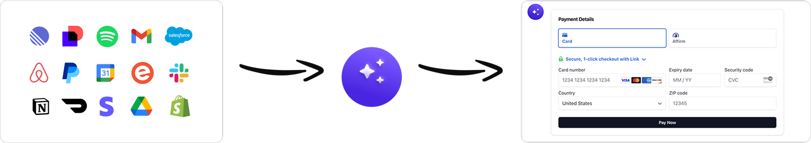

The agent calls a tool through VeyraX; VeyraX authenticates on behalf of the user, calls the
underlying API and returns both structured data and a ready-to-render UI component.

<table>
  <tr>
    <td align="center">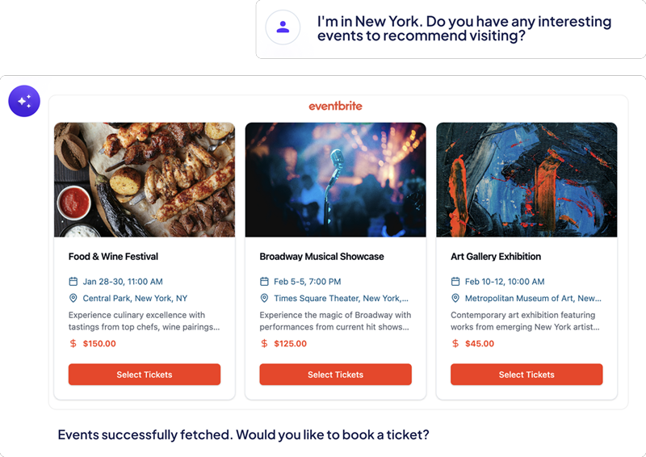</td>
    <td align="center">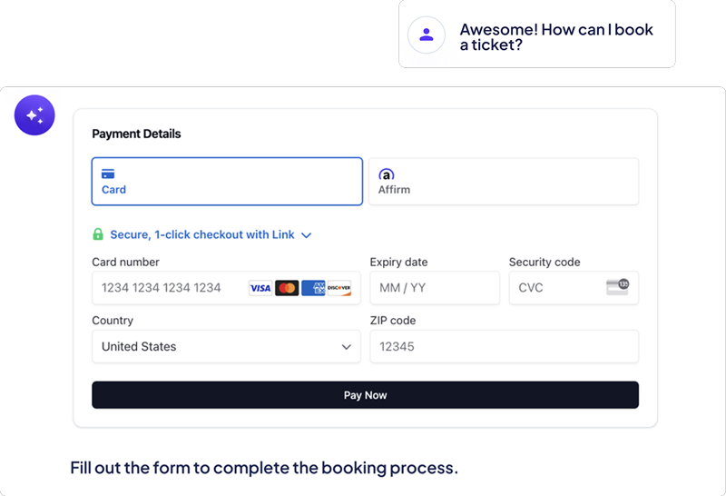</td>
    <td align="center">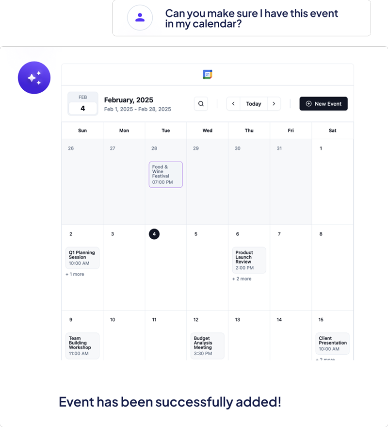</td>
  </tr>
</table>

## Features

- **Tool calling API** — a single, uniform interface (`/tools`, `/tool-call/{tool}/{method}`) over [80+](#integrations)
  integrations: Gmail, Google Calendar/Drive/Docs/Sheets, Slack, Notion, Linear, Jira, Confluence, GitHub,
  Outlook, Dropbox, Asana, Trello, Figma, Airtable, Vercel, Sentry, PostgreSQL, ClickHouse, Snowflake,
  Perplexity, Tavily, Exa, Firecrawl, Browserbase, E2B and many more (see `aci_server/integrations`).
- **OAuth & credential management** — users connect their accounts once; tokens and API keys are stored
  encrypted (AES) and injected into tool calls on their behalf.
- **MCP** — expose all connected tools to MCP clients, and deploy any GitHub-hosted MCP server
  "in two clicks" (Dockerfile generation, build via GitHub Actions, push to Docker Hub).
- **Memory** — retain information automatically across user requests and make it available to any agent.
- **Flows** — describe a routine in natural language, turn it into an agent-powered multi-step workflow,
  run it on demand or on a schedule.
- **Semantic tool search** — vector index over tools and providers so agents can find the right tool.
- **UI components** — integrations return structured components (`component.json`) that the frontend renders.

### Screenshots

| Integrations catalog | Connect a tool |
|---|---|
| 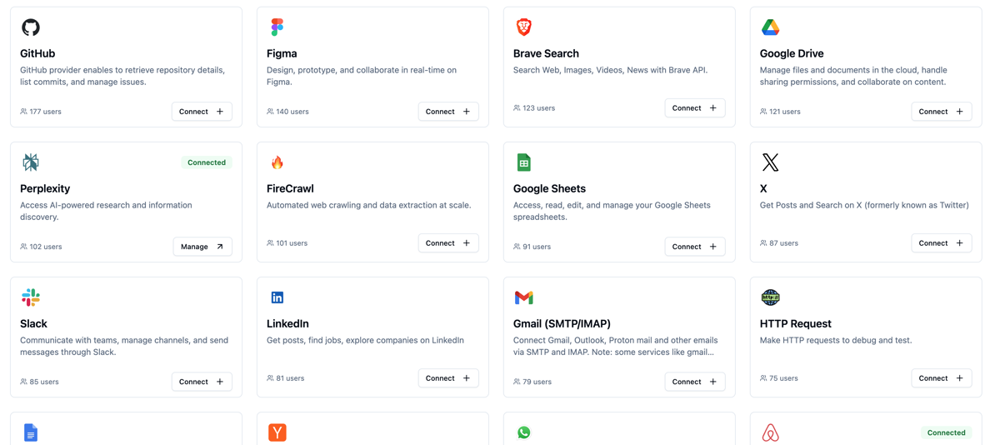 | 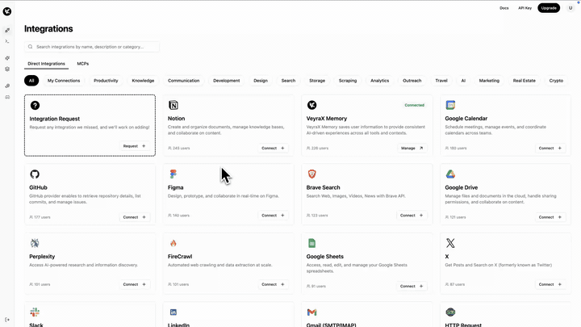 |
| **Deploy an MCP server from GitHub** | **Create a flow from a prompt** |
| 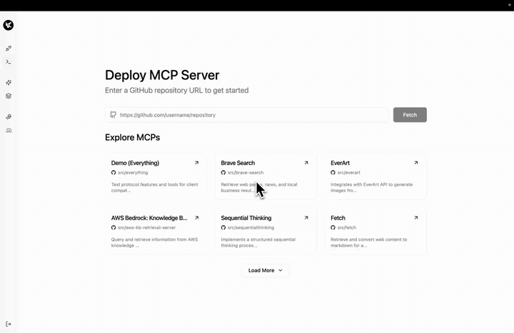 | 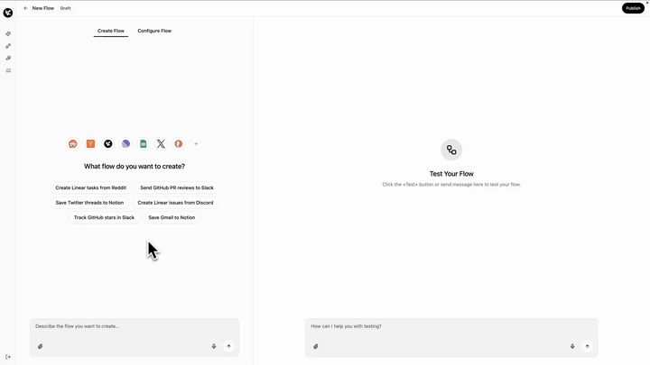 |
| **Memory** | **Flow overview & API** |
| 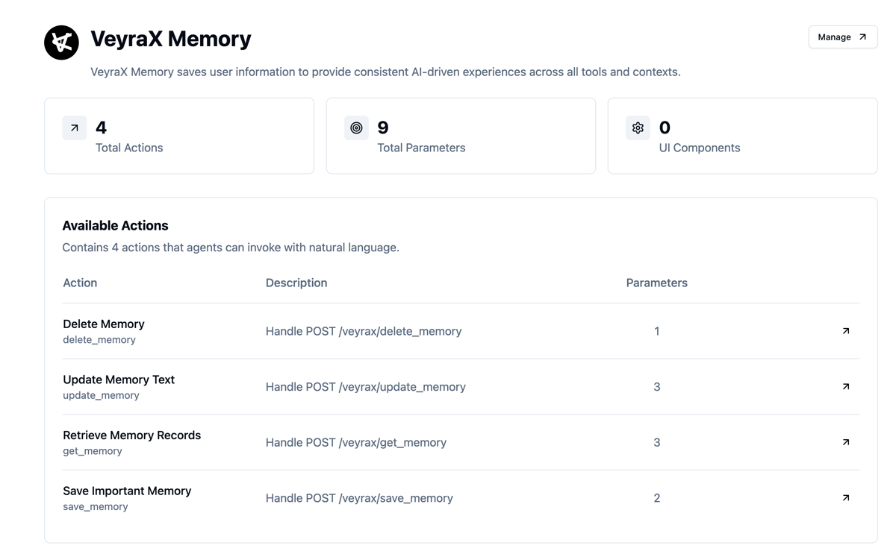 | 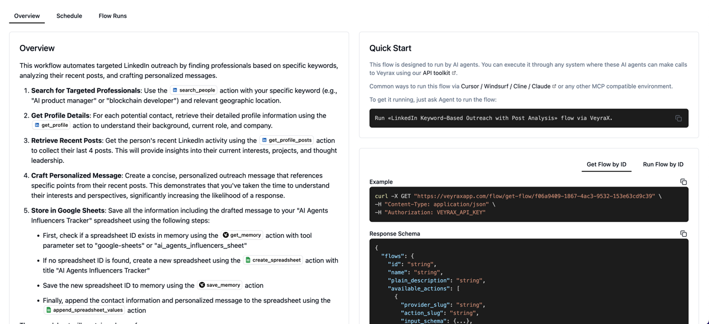 |
| **Auth for your users** | **Explore & deploy MCPs** |
| 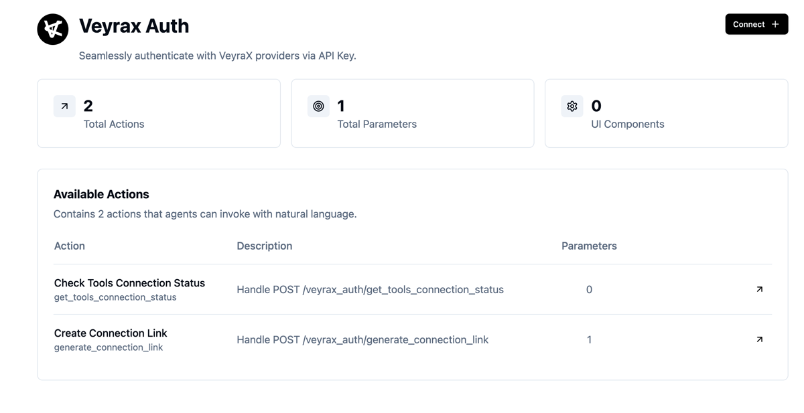 | 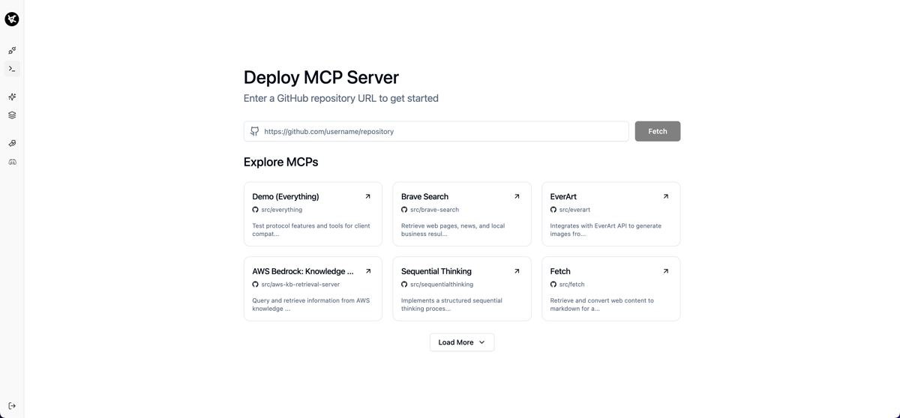 |

## Architecture

| Path | Description |
|------|-------------|
| `aci_server/` | Python backend: FastAPI app, integrations, agent runtime (OpenAI Agents SDK / OpenRouter), flows, memory, MCP deployment, Celery workers |
| `aci_server/integrations/<name>/` | One folder per integration: `client.py`, `service.py`, `route.py`, `schema.py`, `examples.yaml`, `component.json`, `tests.py` |
| `main/` | Next.js 14 web app: landing, dashboard, integrations, playground, flows, settings, billing (Stripe) |
| `services/whatsapp-bridge/` | Go service exposing WhatsApp through a REST API |
| `nginx/`, `docker-compose*.yml` | Deployment configuration (reverse proxy, Celery/Flower, Redis, Datadog) |
| `.github/workflows/` | GitHub Action that builds and publishes MCP server images |

Main dependencies: Supabase (Postgres + Auth + Storage), Redis, Upstash Vector / Qdrant, OpenAI or OpenRouter.

## Integrations

83 integrations live in [`aci_server/integrations`](aci_server/integrations). Each one is exposed as
`/{integration}/{method}` and through the unified `/tool-call/{tool}/{method}` endpoint.

Auth: **OAuth** — user connects an account; **API key** — user's or server key; **RapidAPI** — key from
[RapidAPI](https://rapidapi.com); **Credentials** — host/user/password or connection string; **None** — public API.

Integrations marked with † are implemented but not registered in `INTEGRATION_ROUTERS` (`aci_server/main.py`).

### Productivity & Docs

| Integration | What an agent can do | Auth |
|---|---|---|
| [Airtable](aci_server/integrations/airtable) | Records CRUD, attachments, CSV sync, fields and tables | OAuth |
| [Asana](aci_server/integrations/asana) | Tasks, subtasks, projects, tags, teams, workspaces | OAuth |
| [Cal.com](aci_server/integrations/cal) | Bookings (create, reschedule, cancel), schedules, event types | API key |
| [Coda](aci_server/integrations/coda) | Docs, pages, tables, columns and rows, page export | API key |
| [Confluence](aci_server/integrations/confluence) | Spaces, pages CRUD, content search | OAuth |
| [DocuSign](aci_server/integrations/docusign) † | Envelopes, documents, signing views | OAuth |
| [Dropbox](aci_server/integrations/dropbox) | Files and folders: list, upload, download, move, share, search | OAuth |
| [Figma](aci_server/integrations/figma) | Files, nodes, images, components, styles, team projects | OAuth |
| [Google Calendar](aci_server/integrations/google_calendar) | Calendars and events CRUD | OAuth |
| [Google Docs](aci_server/integrations/google_docs) | Create, read, edit and search documents | OAuth |
| [Google Drive](aci_server/integrations/google_drive) | Files and folders, upload/download, permissions | OAuth |
| [Google Sheets](aci_server/integrations/google_sheets) | Read/write/append values, sheets, formulas, search | OAuth |
| [Motion](aci_server/integrations/motion) | Tasks, recurring tasks, projects, comments, schedules | API key |
| [Notion](aci_server/integrations/notion) | Databases, pages, blocks, search, users | OAuth |
| [Readwise](aci_server/integrations/readwise) | Save, list, update and delete Reader documents | API key |
| [TickTick](aci_server/integrations/ticktick) | Tasks and projects | OAuth |
| [Todoist](aci_server/integrations/todoist) | Projects, sections, tasks, labels, comments | OAuth |
| [Trello](aci_server/integrations/trello) | Boards, lists, cards, checklists, organizations | OAuth |
| [Typeform](aci_server/integrations/typeform) | Forms, responses, webhooks, workspaces | API key |

### Communication

| Integration | What an agent can do | Auth |
|---|---|---|
| [Gmail](aci_server/integrations/gmail) † | Read, send and delete messages, drafts | OAuth |
| [Mail (IMAP/SMTP)](aci_server/integrations/mail) | Any mailbox: read, send, folders, auto-detect server settings | Credentials |
| [Outlook](aci_server/integrations/outlook) | Messages, drafts, calendars and events | OAuth |
| [Resend](aci_server/integrations/resend) | Send emails (single/batch), broadcasts, domains, audiences, contacts | API key |
| [Slack](aci_server/integrations/slack) | Channels, messages, DMs, threads | OAuth |
| [WhatsApp](aci_server/integrations/whatsapp) | Chats, messages, contacts via the [WhatsApp bridge](services/whatsapp-bridge) | QR pairing |

### Developer tools & Infrastructure

| Integration | What an agent can do | Auth |
|---|---|---|
| [21st.dev](aci_server/integrations/twentyfirst_dev) | Search UI components, generate component prompts | API key |
| [Browser Use](aci_server/integrations/browser_use) | Run and control browser automation tasks | API key |
| [Browserbase](aci_server/integrations/browserbase) | Headless browser sessions, contexts, logs, recordings | API key |
| [E2B](aci_server/integrations/e2b) | Code sandboxes: run code and commands, files | API key |
| [GitHub](aci_server/integrations/github) | Repositories, issues, pull requests, commits, reviews | OAuth |
| [Jira](aci_server/integrations/jira) | Issues CRUD, projects, statuses, transitions, users | OAuth |
| [Linear](aci_server/integrations/linear) | Issues (search, create, update, comment), projects, teams | OAuth |
| [n8n](aci_server/integrations/n8n) | Workflows, executions, users, credentials, tags | API key |
| [PostHog](aci_server/integrations/posthog) | HogQL queries, insights, dashboards, events, projects | API key |
| [Postman](aci_server/integrations/postman) | Collections, environments, workspaces | API key |
| [Sentry](aci_server/integrations/sentry) | Teams, projects, issues, releases, alert rules | OAuth |
| [UploadThing](aci_server/integrations/uploadthing) | File uploads (incl. from URL), file management | API key |
| [Vercel](aci_server/integrations/vercel) | Projects, deployments, domains, environment variables | OAuth |

### Databases

| Integration | What an agent can do | Auth |
|---|---|---|
| [ClickHouse](aci_server/integrations/clickhouse) | Run queries, list tables and columns | Credentials |
| [Neon](aci_server/integrations/neondb) | Run queries, list tables and columns | Credentials |
| [PostgreSQL](aci_server/integrations/postgresql) | Run queries, list tables and columns | Credentials |
| [Snowflake](aci_server/integrations/snowflake) | Run queries, list tables and columns | Credentials |
| [Supabase](aci_server/integrations/supabase) | Run queries, list tables and columns | Credentials |

### Search & Web

| Integration | What an agent can do | Auth |
|---|---|---|
| [Brave Search](aci_server/integrations/brave) | Web, image, video and news search | API key |
| [DuckDuckGo](aci_server/integrations/duckduckgo) | Search and fetch page content | None |
| [Exa](aci_server/integrations/exa) | Neural search, page contents, similar pages | API key |
| [Firecrawl](aci_server/integrations/firecrawl) | Scrape, crawl, map sites, structured extraction | API key |
| [Hacker News](aci_server/integrations/hacker_news) | Top/new/best stories, items, comments, users | None |
| [Tavily](aci_server/integrations/tavily) | Web search and content extraction | API key |
| [YouTube](aci_server/integrations/youtube) | Search videos, video details, captions, transcripts | API key |

### AI & Media

| Integration | What an agent can do | Auth |
|---|---|---|
| [Bannerbear](aci_server/integrations/bannerbear) | Generate images, videos, GIFs and collections from templates | API key |
| [Cloudinary](aci_server/integrations/cloudinary) | Upload, transform, rename and delete assets | API key |
| [fal.ai](aci_server/integrations/falai) | Discover and run generative models, queue status, uploads | API key |
| [HeyGen](aci_server/integrations/heygen) | Avatar videos, voices, templates, translation | API key |
| [Perplexity](aci_server/integrations/perplexity) | Web-grounded chat completions | API key |
| [Replicate](aci_server/integrations/replicate) | Run models, predictions, deployments, trainings | API key |
| [Revid](aci_server/integrations/revid) | Generate and publish short-form videos | API key |

### CRM & Sales

| Integration | What an agent can do | Auth |
|---|---|---|
| [Apollo](aci_server/integrations/apollo) | Search people and organizations, get details | RapidAPI |
| [HighLevel](aci_server/integrations/hilvl) † | Businesses, calendars, slots, contacts and more | API key |
| [Hunter.io](aci_server/integrations/hunterio) | Domain search, email finder/verifier, enrichment | API key |

### Social

| Integration | What an agent can do | Auth |
|---|---|---|
| [Facebook](aci_server/integrations/facebook) | Search and read public pages, posts, groups, events | RapidAPI |
| [Instagram](aci_server/integrations/instagram) | Profiles, posts, comments, followers | RapidAPI |
| [LinkedIn](aci_server/integrations/linkedin) | Profiles, companies, posts, jobs, people search | RapidAPI |
| [Reddit](aci_server/integrations/reddit) | Read, post, comment, edit, vote, search | OAuth |
| [X (Twitter)](aci_server/integrations/x) | Profiles, timelines, tweets, threads, lists, search | RapidAPI |

### Travel, Local & Real Estate

| Integration | What an agent can do | Auth |
|---|---|---|
| [Airbnb](aci_server/integrations/airbnb) | Search listings, listing details | None |
| [Google Maps](aci_server/integrations/google_maps) | Geocoding, places, directions, distance matrix, elevation | API key |
| [Skyscanner](aci_server/integrations/skyscanner) | Flights (one-way, round-trip, anywhere), price calendars, hotels | RapidAPI |
| [Yelp](aci_server/integrations/yelp) | Search businesses, details, reviews, menus | RapidAPI |
| [Zillow](aci_server/integrations/zillow) | Properties, Zestimates, comps, market data | RapidAPI |

### Commerce & Finance

| Integration | What an agent can do | Auth |
|---|---|---|
| [Amazon](aci_server/integrations/amazon) | Product search, items, variations, browse nodes (PA-API) | API key |
| [Binance P2P](aci_server/integrations/binance_p2p) | P2P crypto offers | RapidAPI |
| [Bybit P2P](aci_server/integrations/bybit_p2p) | P2P crypto offers | RapidAPI |
| [OKX P2P](aci_server/integrations/okx_p2p) | P2P crypto offers | RapidAPI |

### Utilities

| Integration | What an agent can do | Auth |
|---|---|---|
| [Dub](aci_server/integrations/dub) | Short links (bulk too), QR codes, analytics, events | API key |
| [HTTP Request](aci_server/integrations/http_request) | Call any HTTP endpoint | None |
| [IPinfo](aci_server/integrations/ipinfo) | IP geolocation (single/bulk), ASN info | API key |
| [OpenWeather](aci_server/integrations/openweather) | Weather forecast | API key |
| [SVGL](aci_server/integrations/svgl) | Search SVG brand logos by name or category | None |
| [Zip Code](aci_server/integrations/zip_code) | Look up places by zip code or city | None |

### VeyraX

| Integration | What an agent can do | Auth |
|---|---|---|
| [VeyraX Memory](aci_server/integrations/veyrax) | Save, get, update and delete user memories | VeyraX API key |
| [VeyraX Auth](aci_server/integrations/veyrax_auth) | Tool connection status, connection links | VeyraX API key |
| [VeyraX MCP](aci_server/integrations/veyrax-mcp) † | Search and deploy MCP servers, connection links | VeyraX API key |

## Quickstart

You need [Docker](https://docs.docker.com/get-docker/) (running), the
[Supabase CLI](https://supabase.com/docs/guides/local-development/cli/getting-started) and Node.js 18+. Then, from the
repository root:

```bash
./quickstart.sh
```

One command, safe to re-run. It:

1. starts a local Supabase with the full schema and the tool catalog (79 integrations, ~930 actions);
2. creates `.env` and `main/.env.local` for it (existing files are kept);
3. starts the backend with Docker Compose and the frontend with Next.js;
4. runs a smoke test: creates a demo user and an API key, connects Hacker News and calls a tool through the backend.

At the end it prints where everything runs:

| What | Where |
|---|---|
| App | http://localhost:3000, log in as `demo@example.com` / `demo-password-123` |
| Backend API docs | http://localhost:8000/docs |
| Supabase Studio | http://127.0.0.1:54323 |
| Demo API key | printed, together with a ready-to-run `curl` tool call |

The first run takes a few minutes (Docker images, npm packages); later runs take under a minute. Stop everything with
`./quickstart.sh stop`; the database is kept.

- Tools with an API key or no auth work right away. The agent, chat and flows need LLM keys: run
  `OPENAI_API_KEY=... OPENROUTER_API_KEY=... ./quickstart.sh` before `.env` exists, or add them to `.env` and
  `main/.env.local` later.
- OAuth integrations (Slack, Notion, …) also need your own OAuth app credentials in `.env`.
- If another local Supabase project already uses the default ports, the script runs this one on ports 544xx and
  prints the actual URLs.

## Getting started

The sections below are the manual version of what `./quickstart.sh` does.

### Prerequisites

- Docker and Docker Compose
- Node.js 18+ (for the frontend)
- [Supabase CLI](https://supabase.com/docs/guides/local-development/cli/getting-started) for a local database,
  or a hosted Supabase project
- An OpenAI API key and an OpenRouter API key

### Database

The schema lives in [`supabase/migrations`](supabase/migrations) and the tool catalog (79 integrations, ~930 actions,
OAuth scopes) in [`supabase/seed.sql`](supabase/seed.sql).

**Local (recommended):**

```bash
supabase start            # first run pulls images; applies migrations + seed.sql
supabase status -o env    # URLs and keys for the .env files
```

Use the legacy JWT keys from `supabase status -o env`: `ANON_KEY` and `SERVICE_ROLE_KEY`. The new `sb_publishable_…` /
`sb_secret_…` keys are rejected by the pinned `supabase` Python client. `supabase db reset` wipes the local database and
re-applies everything. Studio runs at `http://127.0.0.1:54323`.

`port is already allocated` means another local Supabase project uses the default ports: stop it with
`supabase stop --project-id <name>` (its data is kept), or see
[Running multiple local projects](https://supabase.com/docs/guides/local-development/running-multiple-local-projects).

**Hosted Supabase project:**

```bash
supabase link --project-ref <your-project-ref>
supabase db push --include-seed
```

Or run the files from `supabase/migrations/` (in order) and then `supabase/seed.sql` in the SQL Editor.

**Plain PostgreSQL 15+ with psql (no Supabase, e.g. for a quick check or CI):**

```bash
supabase/psql/test.sh                     # throwaway local cluster, removed afterwards (needs initdb 15+)
supabase/psql/test.sh postgresql://...    # or an existing empty database
```

It applies [`supabase/psql/bootstrap.sql`](supabase/psql/bootstrap.sql) (the Supabase roles and `auth` helpers), then the
migrations and `seed.sql` twice to check idempotency. It finishes with RLS smoke checks run as `anon`, two users and
`service_role`, inside a transaction that is rolled back.

Billing views read Stripe data from a `stripe` schema. The baseline migration creates empty placeholder tables there; to
show real subscriptions, replace them with the [Supabase Stripe Wrapper](https://supabase.com/docs/guides/database/extensions/wrappers/stripe).

### Configuration

1. Backend: `cp .env.example .env` and fill in the **REQUIRED** section.
2. Frontend: `cp main/.env.example main/.env.local` and fill in the **REQUIRED** section.
3. Never commit real `.env` files — they are git-ignored.

With local Supabase the backend runs in Docker, so it reaches the database at `http://host.docker.internal:54321`.
The frontend runs on the host and uses `http://127.0.0.1:54321`.

Everything in the **OPTIONAL** sections can stay empty: only the integrations and features you configure will work.

### Tool catalog

`supabase/seed.sql` is generated; don't edit it by hand. Its sources:

- the integrations registered in `INTEGRATION_ROUTERS` (`aci_server/main.py`): input/output schemas, `examples.yaml`,
  `component.json`;
- [`aci_server/db/scripts/catalog.json`](aci_server/db/scripts/catalog.json): name, description, category, auth method,
  logo, custom auth fields, OAuth scopes and which scopes each action needs.

```bash
# regenerate supabase/seed.sql after changing an integration or catalog.json
docker-compose run --rm --no-deps -v "$PWD/supabase:/supabase" aci_server python db/scripts/seed_tools.py --sql /supabase/seed.sql

# validate only
docker-compose run --rm --no-deps aci_server python db/scripts/seed_tools.py --dry-run

# upsert the catalog into the database from .env (SUPABASE_URL / SUPABASE_SERVICE_KEY) without resetting it
docker-compose run --rm --no-deps aci_server python db/scripts/seed_tools.py            # all integrations
docker-compose run --rm --no-deps aci_server python db/scripts/seed_tools.py slack exa  # only some
```

Seeding is idempotent and never deletes rows. Actions of an OAuth integration are enabled for a user only if they
are listed in that integration's `action_scopes`.

### Run the backend

```bash
docker-compose up --build
```

The API is available at `http://localhost:8000` (OpenAPI docs at `/docs`), Celery Flower at `http://localhost:5555`.

### Run the frontend

```bash
cd main
npm install
npm run dev
```

The web app is available at `http://localhost:3000`.

## Integration tests

1. Run all tests in Docker
```bash
docker-compose exec aci_server /app/run_tests.sh
```

2. Run tests for a specific integration
```bash
docker-compose exec aci_server /app/run_tests.sh dropbox
```

## Adding an integration

See [CONTRIBUTING.md](CONTRIBUTING.md#adding-an-integration).

## Contributing & security

Contributions are welcome — see [CONTRIBUTING.md](CONTRIBUTING.md). To report a vulnerability, follow [SECURITY.md](SECURITY.md).

## License

[MIT](LICENSE)
